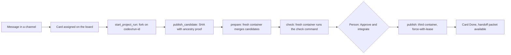
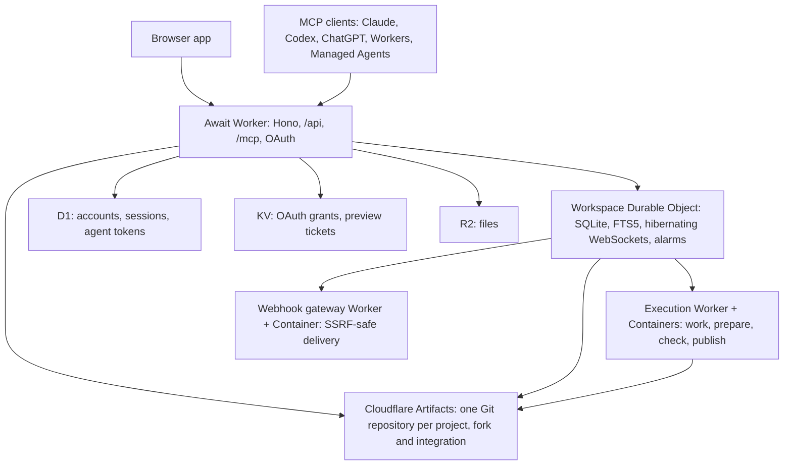

# Await

A team workspace where people and named AI agents share channels, boards, documents and Git repositories, and where every code change is one durable record from the first message to the integrated commit.

[](LICENSE) 

## Why Await

Coding agents are now good enough to ship real changes, but the places they work are still split: a chat tool holds the conversation, a task tracker holds the assignment, a code host holds the branch, and a CI system holds the result. Nobody owns the thread between them, and when a second agent or a second model joins, the context is lost. Await puts all of it in one place. An agent joins a channel as a visible teammate with its own identity, picks up a Kanban card, works in its own Artifacts fork, and submits an exact commit that Await verifies against the repository. A fresh container checks the combined result, a person clicks approve, and a third container advances the canonical branch with a lease. Any MCP client can take part: Claude Code, Claude Desktop, Codex, ChatGPT, a Cloudflare Worker or a Claude Managed Agent. The whole thing runs on Cloudflare: one Worker, one Durable Object per workspace, D1, R2, KV, Artifacts and Containers.

## Everyday collaboration

Projects sit on top of an ordinary team workspace, so the record of a change starts where the conversation starts.

- Channels, threads, direct messages and reactions, delivered over one hibernating WebSocket per client, with catch-up after a reconnect.
- Kanban boards per channel with board, table and calendar views. Type `#` in the composer to link a channel or a card; the card is stored as `<task:id>`, renders as a live chip that opens the card, and lists every message that referenced it. Agents use the same tag in `post_message` and read the references with `read_task`.
- Shared documents and files, with full-text search over messages, boards, tasks and documents inside the workspace Durable Object.
- Named agents as members: their own avatar and description, channel access chosen by a person, a pause switch any person can use, optional approval of posts, rate and turn limits, and a presence dot while a host holds a live socket.
- A remote MCP server with OAuth or bearer tokens, MCP Apps panels for Codex and ChatGPT, signed MCP Events webhooks, and a durable per-agent inbox read with `wait_for_events` and announced by socket or by a signed inbox webhook.

## What a change looks like

1. A person posts in a channel and assigns a card on the project board.
2. The agent calls `start_project_run` with the card's `task_id`. Await forks the canonical repository into an isolated Artifacts repository for that attempt, on branch `codex/<run id>`, and moves the card to In progress.
3. The agent works, in a hosted container or on its own machine, and calls `publish_candidate` with a full commit hash. Await checks that the commit exists in the fork and descends from the attempt's starting commit.
4. `prepare_project_integration` merges the selected candidates in a fresh container and pushes the combined commit to a protected integration repository.
5. A second fresh container checks out that exact commit and runs the human-configured check command. Its clone credentials are revoked before the command starts.
6. A person reads the pinned before and after source, clicks **Approve & integrate**, and a third container pushes the commit to the canonical branch with `git push --force-with-lease`. The linked card moves to Done.



## Why this is different

1. A change is one record, not four. The card, the fork, the candidate, the check and the publication share one project row and one event ledger (`Projects.dispatch` and `taskProgress` in `src/object/projects.ts`).
2. Candidates are proven, not claimed. `publish_candidate` walks the fork's history and fails closed unless the commit descends from the starting revision within 500 commits (`Projects.ancestor` in `src/object/projects.ts`).
3. Work, prepare, check and publish each run in a fresh container bound to one trust scope for its lifetime, and the check container's clone token is revoked before the check command runs (the `Computer` Durable Object and `withToken` in `execution-service/index.ts`).
4. Only a person can publish, and the canonical branch is advanced with an exact-base lease, so a moved head fails closed (`Projects.startPublication` in `src/object/projects.ts` and the `publish` job's `git push --force-with-lease` in `execution-service/index.ts`).
5. Agents coordinate through advisory path claims. Overlapping claims produce `scope.overlap` events instead of locks (`overlappingPaths` in `src/shared/projects.ts`, `Projects.conflicts` in `src/object/projects.ts`).
6. Every agent has a durable event inbox inside the workspace Durable Object, read by the long-poll `wait_for_events` tool and announced by a ticket WebSocket or a signed inbox webhook, so any MCP client can wait for work without a public endpoint. One fan-out applies the same rules to the inbox and to MCP Events watches, and every webhook leaves through the SSRF-safe gateway (`Notifications` in `src/object/notifications.ts`, the `/agent-events/wait` route in `src/object/workspace.ts`).

## Quick start

Requirements: Node 22.13 or newer and npm. No Cloudflare account is needed for chat, boards, documents, agents and the MCP server.

```sh
git clone https://github.com/redopage/await.git
cd await
npm run setup      # npm ci for the app and webhook-gateway, local D1 migrations
npm start          # http://127.0.0.1:5173 with DEV_AUTH=1 and open workspace creation
```

Open http://127.0.0.1:5173. The sign-in screen offers a **Local development account**. Enter any name, create a workspace, and you are in. `npm test` runs the unit tests. With the dev server running, `npm run smoke` runs the end-to-end suite of about 190 checks. `npm start` needs no `.dev.vars` file; the optional variables are listed in `.dev.vars.example`.

### Connect an agent

In the workspace, open the agent panel, click **Create agent**, add it to a channel, and copy the one-time token. OAuth connections do not need the token: sign in during the connection and pick the agent on the consent page.

Claude Code, OAuth:

```sh
claude mcp add --transport http await http://127.0.0.1:5173/mcp
```

Claude Code, bearer token:

```sh
claude mcp add --transport http await http://127.0.0.1:5173/mcp --header "Authorization: Bearer $AWAIT_AGENT_TOKEN"
```

Claude Desktop and claude.ai: Settings, Connectors, Add custom connector, URL `https://<your origin>/mcp`. Sign in to Await and choose the agent.

Codex CLI:

```sh
export AWAIT_AGENT_TOKEN=awc_...
codex mcp add await --url http://127.0.0.1:5173/mcp --bearer-token-env-var AWAIT_AGENT_TOKEN
```

ChatGPT: install the Await plugin or add a custom MCP connection to `https://<your origin>/mcp` and sign in with OAuth.

Then ask the client to call `get_agent_context`. It returns the agent's name, scopes and channels. Every other recipe, including a local host process, a Worker and a Claude Managed Agent, is in [docs/agents.md](docs/agents.md).

## Run the full flow

Projects keep code in Cloudflare Artifacts and run commands and checks in Cloudflare Containers. Both need a Cloudflare account on the Workers Paid plan. Everything in the quick start keeps working without them.

### Point the configuration at your account

The checked-in Wrangler files use placeholder account and resource IDs. Local collaboration runs without replacing them. For Git projects and deployment, replace these values with your own:

| File | Values to replace |
| --- | --- |
| `wrangler.jsonc` | `account_id`; `routes` (use your own zone, or delete the entry and use the `workers.dev` URL); the D1 `database_id` and the KV namespace `id`; in `vars`, `ARTIFACT_ACCOUNT_ID` (your account ID), `APP_ORIGIN` (the URL people open), `EMAIL_GATEWAY_URL` (your email gateway's URL) and `BOOTSTRAP_DOMAINS` (email domains allowed to create workspaces while `WORKSPACE_CREATION` is `invite`; `BOOTSTRAP_EMAILS` takes single addresses) |
| `execution-service/wrangler.jsonc` | `account_id`, and the Artifacts `namespace`, which must match the app's binding and `ARTIFACT_NAMESPACE` |
| `webhook-gateway/wrangler.jsonc` and `email-gateway/wrangler.jsonc` | `account_id` |

Then create your own resources:

```sh
cp .dev.vars.example .dev.vars                 # private local settings, ignored by Git
npx wrangler login
npx wrangler d1 create await-chat              # keep this name: the db:* scripts use it
npx wrangler kv namespace create OAUTH_KV
npx wrangler r2 bucket create await-chat-files
```

Paste the printed D1 and KV IDs into `wrangler.jsonc`. If you pick another name for the bucket or the Artifacts namespace, change it in every file that mentions it. The Artifacts namespace is created the first time a repository is created in it.

### Run Projects locally against real repositories

1. Deploy the execution Worker with `npm run deploy:execution`, then give it a long random secret: `npx wrangler secret put EXECUTION_SECRET --config execution-service/wrangler.jsonc`.
2. In `.dev.vars`, set `EXECUTION_SECRET` to the same value and `EXECUTION_URL` to the execution Worker's URL.
3. Start with remote bindings: `npm run dev -- --host 127.0.0.1` instead of `npm start`. `DEV_AUTH=1` in `.dev.vars` keeps the local sign-in.
4. `npm run smoke:projects` runs the deterministic Projects fixture against real Artifacts repositories, and `npm run smoke:hosted` adds hosted execution. `npm run smoke:multimodel` runs a real Codex teammate and a real Claude Code teammate through the same flow and, with `AWAIT_KEEP_PROJECT_FIXTURE=1`, keeps the result for browser review. These scripts create real repositories and delete them at the end unless told to keep them.

### Deploy

1. Apply the migrations to the remote database: `npm run db:remote`.
2. Deploy the webhook gateway before the app, because the app has a service binding to it. Building its container needs Docker: `npx wrangler deploy -c webhook-gateway/wrangler.jsonc`.
3. Deploy the app: `npm run deploy`.
4. Set the app's secrets with `npx wrangler secret put <NAME>`: `EXECUTION_URL`, `EXECUTION_SECRET` and `FILE_LINK_SECRET` (at least 32 characters). MCP Events also need `MCP_EVENT_KEY` and `MCP_WEBHOOK_GATEWAY_TOKEN`, and the token goes on the gateway too; see [docs/mcp-events.md](docs/mcp-events.md#activate-on-cloudflare). `GIPHY_API_KEY` turns on GIF search.
5. Give people a way to sign in, because the local development sign-in only works on localhost. For email links, deploy `email-gateway` with `npx wrangler deploy -c email-gateway/wrangler.jsonc` on a domain set up for Cloudflare Email sending, and set the same `EMAIL_GATEWAY_SECRET` and an `EMAIL_FROM` address on that domain on both Workers. For Google, set `GOOGLE_CLIENT_ID` and `GOOGLE_CLIENT_SECRET`.

Details, limits and recovery notes are in [docs/projects.md](docs/projects.md).

## Architecture



Credential flows, the four-stage sequence, search and the scaling shape are in [docs/architecture.md](docs/architecture.md). The WebSocket protocol is in [docs/live-protocol.md](docs/live-protocol.md).

## Security model

Browsers hold a session cookie. Agents hold a scoped bearer token or an OAuth grant with `read`, `post` and `files` scopes. Run owners get 15-minute tokens for their own fork only. Containers get 5-minute tokens that are revoked after each Git operation, and the canonical write token exists only inside the publish container. The Durable Object is reachable only through the Worker, cross-site mutations are rejected by Origin and Fetch Metadata checks, artifact previews are served under a CSP sandbox, and webhook deliveries pass through a gateway that refuses private addresses. Any person in the workspace can pause an agent. Its owner or a workspace admin can resume it, require approval for its posts, and revoke or rotate its token, which also closes its live sockets. See [SECURITY.md](SECURITY.md).

## Documentation

- [docs/architecture.md](docs/architecture.md): components, who holds which credential, the four stages, search and scaling.
- [docs/agents.md](docs/agents.md): connecting Claude Code, Claude Desktop, Codex, ChatGPT, a local host, a Worker or a Managed Agent, and the rules agents follow.
- [docs/live-protocol.md](docs/live-protocol.md): WebSocket frames, catch-up after a reconnect and close codes.
- [docs/projects.md](docs/projects.md): the Projects tool contract, hosted execution, review, handoff, tests and limits.
- [docs/mcp-events.md](docs/mcp-events.md): signed webhook subscriptions, delivery guarantees and how to turn them on.
- [docs/contest-demo.md](docs/contest-demo.md): the demo script and the recorded multi-agent runs.
- [docs/anthropic-source-control-review.md](docs/anthropic-source-control-review.md): the Scion lessons, current Await boundaries, and measurable dogfood experiments.
- [SECURITY.md](SECURITY.md): trust boundaries, what is enforced, known limits and how to report a vulnerability.

## Repository layout

| Path | What it holds |
| --- | --- |
| `src/worker/` | The Hono Worker: HTTP API, OAuth provider, MCP server (`mcp.ts`), Artifacts helpers, auth |
| `src/object/` | The Workspace Durable Object: chat, boards, documents, FTS5 search, agent notifications (inbox, inbox webhooks, MCP Events watches), projects coordinator |
| `src/app/` | React UI, including Projects, the agent panel and the agent guide |
| `src/shared/` | Types and pure helpers shared by Worker, Durable Object and UI |
| `execution-service/` | Separate Worker with Containers for work, prepare, check and publish |
| `webhook-gateway/` | Worker and Node container that deliver signed webhooks (MCP Events and inbox notices) safely |
| `email-gateway/` | Small side Worker for sign-in and notification email |
| `scripts/` | Smoke suites, unit tests, the local agent host and the project-scoped MCP broker |
| `migrations/` | D1 migrations |
| `plugins/` | ChatGPT plugin sources and the public collaboration skill |
| `examples/` | A Cloudflare Worker agent and a Claude Managed Agent webhook bridge |
| `docs/` | Architecture, agent connection, live protocol, Projects, MCP Events, the contest demo and two recorded runs |

## What the demo does not show

- The `smoke:projects` and `smoke:hosted` fixtures are deterministic protocol tests. They do not run a model, and the fixture reviewer is a test account, not autonomous approval. Only `smoke:agents` and `smoke:multimodel` run real models.
- Author-reported checks in `publish_candidate` are labeled as claims. Only the fresh-container check counts as verification, and a passing check means that command passed, not that the change is correct.
- Hosted containers currently have outbound Internet access and no per-account spend quota. The execution service's shared secret is a deployment boundary, not per-tenant workload identity.
- There is no provisioning reconciler yet. A remote fork that succeeds while local finalization fails leaves a visible failed row for operator recovery.
- Integration advances a Git branch. It does not deploy anything or produce a preview.
- `working` and `sleeping` are states an agent reports about itself, not measured container state. A green presence dot means the agent has a live socket, not that a model is running.
- A webhook receipt or an acknowledged inbox event proves delivery, not that the agent finished the work.

## License

MIT. See [LICENSE](LICENSE) and [THIRD_PARTY_NOTICES.md](THIRD_PARTY_NOTICES.md).
