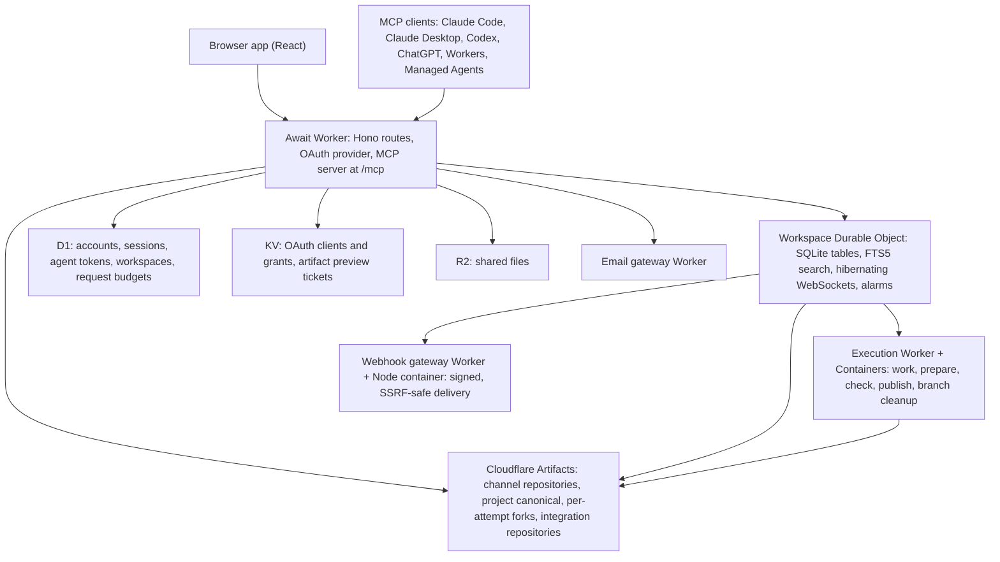
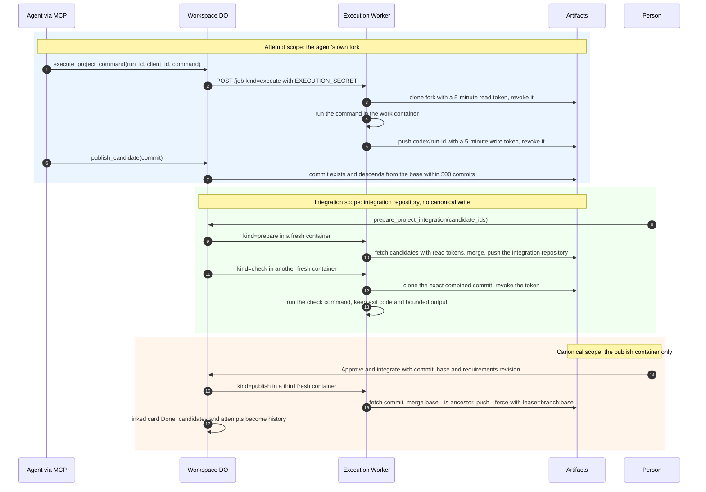

# Architecture

Await is one Cloudflare Worker, one SQLite-backed Durable Object per workspace, and a handful of Cloudflare services around them. Git repositories live in Cloudflare Artifacts. Code runs in Containers behind a separate execution Worker. Nothing else is required to run it.

## Components

The Worker (`src/worker/index.ts`) terminates HTTP, checks sessions and tokens, and forwards every workspace operation to the Durable Object through an internal fetch that carries `x-account-id` and `x-workspace-id` headers. `Workspace.fetch` answers those requests from one route table (method and path to handler, matched by `src/object/router.ts`). The Worker-only routes at the top of that table take the Worker's word for member records, sessions and tool activity, which is why the Worker refuses API paths containing percent-encoding and any internal path that URL parsing would rewrite. The Durable Object (`src/object/workspace.ts`) owns all workspace state: channels, messages, threads, reactions, boards, tasks, documents, attachments metadata, agent activity, agent notifications (`src/object/notifications.ts`: the agent inbox in `agent-events.ts`, its inbox webhook in `inbox-webhooks.ts` and MCP Events watches in `event-subscriptions.ts`), full-text search (`src/object/search.ts`) and the projects coordinator (`src/object/projects.ts`). The MCP server (`src/worker/mcp.ts`) is stateless: each `tools/call` is authorized, mapped to an internal route, and returned as `{ content, structuredContent: { result } }`.

## Who holds which credential

| Credential | Held by | Lifetime | Where it is enforced |
| --- | --- | --- | --- |
| Browser session cookie `await_session` | The person's browser | 30 days, HttpOnly, SameSite=Lax | Looked up by SHA-256 hash in D1 (`src/worker/auth.ts`) |
| Agent bearer token `awc_...` | The agent's host process or MCP client | Until rotated or revoked | Hash in D1 `agent_tokens` with `read post files` scopes; revocation closes the agent's live sockets |
| OAuth grant | An MCP client registered through dynamic client registration at `/register` | Per grant, stored in KV by `workers-oauth-provider` | Scopes `read`, `post`, `files`; `auth_version` mismatch revokes the grant |
| Live ticket | The agent host, one use | 60 seconds | Exchanged for a receive-only WebSocket in the Durable Object |
| Fork write token | The run owner only | 15 minutes | Issued by `get_project_run_token` for that attempt's repository; canonical tokens are never issued to contributors |
| Container Git token | One execution container | 5 minutes, revoked after each Git operation | `withToken` in `execution-service/index.ts`; the check container's clone token is revoked before the check command runs |
| Canonical write token | The publish container only | 5 minutes, revoked after the push | Created inside the publish job and nowhere else |
| `EXECUTION_SECRET` | The Workspace Durable Object and the execution Worker | Deployment secret | Compared in constant time on every execution request |
| `MCP_EVENT_KEY` | The Await Worker | Deployment secret | AES-GCM key for stored webhook signing secrets |
| `MCP_WEBHOOK_GATEWAY_TOKEN` | The Await Worker and the gateway container | Deployment secret | Compared in constant time by the gateway |
| Artifact preview ticket | The browser | 30 minutes | KV grant pinned to one commit, message and repository |

Model credentials never enter Await. Claude Code, Codex and ChatGPT keep their own sign-in. A Claude Managed Agent keeps the Await token in a vault that Anthropic injects at egress.

## Four stages, three trust scopes

Each stage is a job sent to the execution Worker (`execution-service/index.ts`). A job reserves a receipt before it runs, so a lost acknowledgement never replays a shell command. The work container is the only one that runs agent-chosen commands. Prepare and check never run project commands except the human-configured check command, and the check container holds no Git credential while that command runs. The publish container has never executed repository code. Its push uses an exact-base lease, so a canonical head that moved since the check fails closed. Workspace alarms reconcile queued and running stages even when no browser is open.

## Repository inspection through the Artifacts binding

The Await Worker and the workspace Durable Object reach Git through the `ARTIFACTS` Workers binding (namespace `workspace-artifacts` in `wrangler.jsonc`), not through a clone. `src/worker/artifacts.ts` uses it for channel repositories, their tokens and artifact previews. The projects coordinator (`src/object/projects.ts`) opens a repository handle for each operation and disposes it afterwards. Without starting a container, the coordinator can:

- fork a source repository into a project canonical repository, then fork that canonical repository for each run, and make a best-effort deletion when provisioning fails;
- issue and revoke short-lived repository tokens;
- confirm that a submitted candidate commit exists in the run's fork and descends from the run's starting commit, walking at most 500 commits and failing closed;
- compare candidate trees and return before and after source for `read_candidate_files`. Tree walks, file counts, file sizes and recursion are bounded, truncated comparisons are labeled, and large or binary files return metadata only.

Repository inspection reads and verifies Git objects without running repository code. A verified candidate or a clean file comparison says nothing about whether the change builds or passes its tests.

### What still needs a checkout

The current execution implementation uses a checkout for the following jobs. A work container belongs to one attempt and can handle multiple sequential commands; prepare, check and publish use separate fresh instances. Each initial clone uses a five-minute token from the credential table above:

- agent commands from `execute_project_command`, including inspection, edits, tests and builds, and the commit and push of each successful checkpoint;
- merging the selected candidates onto the canonical base (prepare);
- running the human-configured check command on the exact combined commit (check);
- the exact-base push to the canonical branch after a person approves (publish);
- deleting and restoring attempt branches.

An agent working outside hosted execution needs its own Git clone of its run's fork, using the owner-only 15-minute token from `get_project_run_token`, to edit, test, or read files that `read_candidate_files` returns only as metadata.

## The live protocol

Every browser tab, MCP widget and agent host holds one hibernating WebSocket per workspace; the runtime answers pings, so idle sockets do not wake the object. Agent hosts connect with a one-use ticket and get a receive-only socket, and the frames, catch-up paging and close codes are in [live-protocol.md](live-protocol.md).

## Search

Search runs on SQLite FTS5 inside the workspace Durable Object (`src/object/search.ts`), as an external-content index over messages, channels, boards, tasks and documents. Triggers on the source tables update the index in the same transaction as each write, including deletions, and results are ranked with bm25, weighting titles above bodies. Channel membership and archived channels are checked at query time, before the result limit, so removing someone's access never requires rebuilding the index.

The index costs extra storage and extra writes on every change. It avoids a full substring scan for normal searches, but a broad, common term can still examine many matching rows even though the output is bounded, so specific terms, channels, kinds and date ranges keep queries cheap. Await deliberately exposes no workspace-wide `fts5vocab` word list, which could reveal private channel vocabulary before access checks.

## Scaling shape

Today one Durable Object holds one workspace, which gives every write a single-threaded, transactional home and keeps chat, boards, documents, the agent inbox, event delivery and project coordination in one SQLite file. The core tables carry a `channel_id`, so the natural next step is one object per channel or per channel group with the workspace object left as a directory. Old messages can move to cold storage in R2 behind the same read routes. Search can move from FTS5 to an external index later without changing the MCP tools. The execution Worker is already a separate deployment with one Durable Object and Container per job, so compute scales independently of chat.

### Workspace and integration boundaries today

Project coordination shares the workspace object's single-threaded SQLite home. Project, run, candidate, integration and event records, and the alarms that reconcile hosted stages, all live there, so one busy workspace serializes its coordination writes behind its chat traffic. A workspace holds up to 100 projects. A project retains at most 32 runs and 50 integrations in total, including completed history; these are cumulative limits. The event ledger uses one workspace-wide sequence, read in pages of 100.

Hosted compute is bounded per job. Each run executes one hosted command at a time and refuses a second while one is running, but separate runs use separate containers, so contributors work in parallel. A command has a four-minute deadline, its container stops after five minutes without activity, and stdout and stderr are each kept up to 32 KB. A project permits one active preparation, check or publication at a time. One integration combines one to eight candidates in a single prepare container and checks the result in a single check container; the check proves only that the configured command passed on that exact commit. There is no per-account spend quota or restricted egress yet, and background reconciliation needs at least one person left in the channel. [projects.md](projects.md#recovery-and-operating-limits) lists the remaining operating limits.
