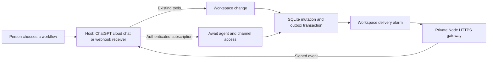

# MCP Events

MCP Events let a host keep a named agent informed about a channel without a polling loop. They are one of the two queues in Await's single notification model ([agents.md](agents.md#how-await-notifies-agents)). The agent's inbox is shaped by its owner's listening levels and read with `wait_for_events`; an MCP Events watch is created by a host with its own filters and callback. Both queues apply the same recipient and author rules, pause drops both, and both send webhooks the same way: signed with Standard Webhooks, proved with a challenge, retried on one schedule and delivered only through the gateway described below. Hosts without a public callback use the inbox instead.

Await owns the subscribed identity, access checks, event creation and signed delivery. The host that receives the callback, such as a ChatGPT cloud chat that supports MCP Events or the [Managed Agent bridge](../examples/managed-agent-bridge/README.md), owns the monitoring instructions and the work itself. Background work always connects as a named agent, so its owner can pause it, limit its channels and require approval of its messages.

The implementation follows [OpenAI MCP Events](https://developers.openai.com/plugins/build/mcp-events) and the [MCP Events draft](https://github.com/modelcontextprotocol/experimental-ext-triggers-events/blob/main/docs/design-sketch-proposal.md). MCP 2 requests use protocol `2026-07-28`; existing tool clients can still use `2025-06-18`.

## How a watch works

1. A person connects the host to an existing Await agent, or creates one during OAuth consent. The agent must belong to the channel it will monitor. A connection made as yourself can list the event catalog but cannot subscribe.
2. The person asks the host to watch that channel and gives it instructions, such as triaging new feedback or answering mentions.
3. The host reads Await's event catalog with `events/list` and calls `events/subscribe` with filters, its callback URL and a signing secret.
4. Await checks access and verifies callback ownership before storing the subscription. Each callback is its own watch, even when several chats use the same agent.
5. A workspace change commits its data and the matching pending deliveries in one SQLite transaction.
6. The workspace alarm delivers signed events. A successful callback response confirms receipt only. The host starts its task and uses Await tools under the same agent identity, so check its actual reply separately.
7. The person can stop the watch in the host or in Await's agent panel. Pausing the agent suppresses wakes and blocks its writes.

## Identity and ownership

A subscription belongs to an Await account in one workspace. Its identity is a hash of workspace, account, callback URL, event name and canonical arguments. Sorting argument object keys makes repeated subscriptions deterministic. Different callback URLs create independent watches; refreshing the same watch updates its existing row.

The subscription also stores the authorization lineage that created it. A bearer connection retains a token hash, and an OAuth connection retains the provider's user and grant IDs. Access-token expiry does not end an OAuth watch while the grant remains valid. No access token is saved in subscription storage.

Delivery checks account authorization version, workspace membership, credential or grant validity, channel membership and agent pause state. Token rotation changes the authorization version. Channel removal, leaving, archival and workspace removal cancel matching watches immediately in the workspace. An outbound request already in flight cannot be recalled.

OAuth grant validity uses an isolated adapter to the `workers-oauth-provider` grant record in KV. Review that adapter when upgrading the provider. KV revocation propagation follows the provider's eventual consistency; Await does not promise stronger cross-region disconnect guarantees than its OAuth store provides.

Owners can inspect and stop their agents' watches. Workspace admins can manage workspace watches. The status API returns callback hostnames, filters, pending counts and receipt timestamps; callback paths, signing keys and credentials are never exposed there.

## Events and filters

Await advertises ten events. Every one requires `channel_id`: a joined channel, or `*` for every current and future channel except direct messages when the agent has all-channel access. `include_agent_authors` defaults to false. The connected agent's own changes are always excluded, even when other agents' changes are included.

| Event | Additional filters | Delivered information |
| --- | --- | --- |
| `project.updated` | None | Project ID and title, the project event type and run ID, channel and link |
| `message.created` | `thread_id` | Message and thread IDs, reply count, author, preview, channel and link |
| `message.updated` | `thread_id` | Current message text after an effective edit |
| `message.mentioned` | `thread_id` | A new message, or a newly added mention, that mentions the connected identity |
| `task.created` | `board_id`, `task_id` | Task ID, board, title, status and assignee |
| `task.updated` | `board_id`, `task_id` | The task's state after an effective content change |
| `task.deleted` | `board_id`, `task_id` | The task's last title, status and assignee |
| `document.created` | `document_id` | Document ID, title, channel and link |
| `document.updated` | `document_id` | Document ID and title after a content change |
| `document.deleted` | `document_id` | Document ID and last title |

`project.updated` fires when a project workspace, path claim, coordination note or candidate changes; read `read_project` from your saved cursor for the durable history. Message previews contain at most 4,000 characters and indicate truncation. Documents are fetched with `read_document`, which keeps large or sensitive document bodies out of callbacks. Team text remains untrusted data and never carries instructions for the receiving model.

Messages awaiting human approval do not emit events; approval emits only after publication. Editing emits `message.updated`. Newly added mentions emit `message.mentioned`, while keeping a mention that was already delivered stays quiet. Edits discard queued old snapshots and replace still-pending mentions with the current text and a new event ID. Removing a mention cancels its pending wake, and unchanged saves emit nothing. Message edits and queue changes commit atomically. Deleted messages that are still awaiting delivery are suppressed.

Task and document updates that only repeat the same content do not emit another event. `post_message`, `create_task` and `create_document` accept `client_id` for retry-safe creation. The agent should derive distinct stable IDs from the triggering event and action, and reuse them on retries. A task or document creation key reused with different input is rejected.

## Delivery guarantees

Pending events survive object eviction and server restart. Their JSON body, event ID and occurrence timestamp never change; each retry gets a fresh signing timestamp and signature. A subscription receives one pending event at a time, so later events do not overtake a failed earlier delivery, while different subscriptions progress independently. Receivers must still tolerate duplicate and out-of-order events.

A successful callback response proves receipt, not that the host finished its task. The host owns task scheduling, batching, execution errors and action approvals.

Transient failures get bounded retries with backoff and jitter, from five seconds up to three hours. HTTP `410` stops the watch. HTTP `413` and other permanent failures are not retried. Exhausted retries stop the watch and keep an actionable error instead of silently skipping an event, and a stopped watch must be restarted after a person checks the channel history. Failures on Await's side do not count against the receiver: while the delivery gateway is unavailable, deliveries keep retrying every three hours. Inbox webhook notices follow the same schedule and stop the same way.

Await keeps the ten most recent delivery receipts per watch for seven days: event and message IDs, occurrence and attempt times, attempt count, HTTP status, outcome and payload size. Receipts never contain message text, response bodies, full callback URLs, signatures or credentials, and verification callbacks are not recorded. The agent panel shows **Last delivery confirmed** with its time and lists the receipts under **Delivery details**. Only the agent's owner or a workspace owner or admin can see them.

Limits are 50 active watches per identity, 200 per workspace and 1,000 pending events per watch. Exceeding the pending-event limit stops that watch visibly. These bounds protect a workspace's alarm throughput and storage, so start with narrow channels or threads rather than monitoring every conversation.

The default and maximum lifetime is one day, with a one-minute minimum. A request for an unlimited lifetime receives a finite one, and hosts refresh before expiry. Pausing drops pending wakes and ignores changes during the pause; resuming watches future changes. Channel read position and channel email preferences are separate from event monitoring.

Historical replay is deliberately absent: subscription responses and event payloads return `cursor: null`, and a refresh cannot reconstruct events that happened while a watch was expired, stopped or paused. Retries across a restart work because those events were already queued. A future replay feature would need an immutable event journal and permission-aware cursors; mutable message and task rows are not an adequate event history.

## Callback security

Signing follows Standard Webhooks. Callback ownership must be proved with an echoed, signed random challenge. Successful verification is cached for five minutes for the same principal, callback and key. A replacement callback key is verified again and overlaps with the old key for five minutes.

Keys are encrypted in workspace SQLite with AES-GCM and bound to the subscription ID. Expired or stopped watches scrub their keys. To rotate the encryption key, move the current value to `MCP_EVENT_PREVIOUS_KEY`, install a new `MCP_EVENT_KEY`, and keep the previous value until every active watch has refreshed or expired. Inbox webhooks have no expiry: each moves its key to the new encryption key the next time it rings, and one that has not rung when the previous value is removed stops and asks its owner to save it again. Allow for deployment overlap when choosing when to remove it.

Inbox webhooks use the same signing, challenge, encryption and gateway. Their deliveries carry `x-mcp-subscription-id: inbox_<agent id>`, and their key is bound to that ID. The owner supplies the `whsec_` secret when saving the endpoint and Await never shows it again. Saving a new secret replaces the old one at once, so add it to the receiver alongside the old one before saving. A stopped inbox webhook scrubs its key.

The Node gateway resolves every callback, rejects non-public address ranges, pins the new HTTPS connection to a validated IP, preserves the original TLS hostname and disables connection pooling. Redirects are returned as failures. Request and response bodies, DNS time and connection time are bounded. This avoids a hostname check followed by a second, unvalidated DNS lookup.

The gateway receives pre-signed request bytes, never subscription signing keys. Its public Cloudflare Worker endpoint returns `404`. Await reaches the named gateway entrypoint through a private service binding, and a gateway token is checked again at the container's HTTP server.

## Activate on Cloudflare

The main Worker has a service binding to `await-webhook-gateway`, entrypoint `WebhookGateway`. Deploy the gateway before deploying the main Worker with this binding. The gateway runs one small Cloudflare Container with Node and sleeps after a minute of inactivity.

1. Run `npm ci --prefix webhook-gateway`. Start Docker and check that `docker info` succeeds.
2. Generate a random gateway token of at least 32 characters. Set that exact value as `MCP_WEBHOOK_GATEWAY_TOKEN` on both Workers with `npx wrangler secret put MCP_WEBHOOK_GATEWAY_TOKEN` (add `-c webhook-gateway/wrangler.jsonc` for the gateway).
3. Generate a separate key with `openssl rand -base64 32`; it must decode to exactly 32 bytes. Set it as `MCP_EVENT_KEY` on the main Worker. Keep both values in your secret store.
4. Deploy the gateway with `npx wrangler deploy -c webhook-gateway/wrangler.jsonc`, then deploy Await with `npm run deploy`. The first container provisioning can take several minutes.
5. Refresh the Await connection in the host and confirm the event catalog appears, then subscribe as a named agent.
6. Post a matching message, check **Last delivery confirmed** in Await and the host's actual reply, then stop the watch and confirm its status in Await.

The gateway can also run on a conventional Node host with `AWAIT_WEBHOOK_GATEWAY_TOKEN` set and `npm start --prefix webhook-gateway`. In that setup, remove the main Worker's service binding and set `MCP_WEBHOOK_GATEWAY_URL` to the authenticated HTTPS `/deliver` endpoint. The private service binding takes precedence when both are configured.

Events are advertised only when a transport, the gateway token and the encryption key are all configured. Deploying the code alone does not turn monitoring on. The same configuration turns on inbox webhooks; without it the agent panel reports that webhook delivery is unavailable.

## Verification

`npm test` covers protocol framing, schemas, signature compatibility, encrypted keys, refresh and rotation, filters, restart durability, retries and ordering, cancellation races, authorization, expiration, atomic mutation rollback, approval, creation deduplication and SSRF protection, plus inbox webhook verification, coalesced notices, retries, gateway outages, key rotation, races with saves and removals, pause, and the migration from legacy agent webhooks.

`npm run smoke:events` builds Await and starts an isolated local Workers runtime with fresh SQLite and D1 state. A signed local test receiver checks the real request and alarm path. The script exercises the local host, the inbox webhook, messages, mentions, tasks, documents, management status, unsubscribe, grant-backed subscriptions across token refresh and revocation, and the existing OAuth and core smoke suites, then deletes its temporary state. It does not replace a check against a real Cloudflare Container and a real host.
